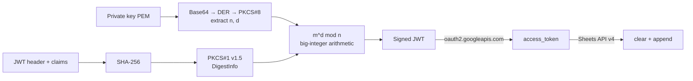

# 1C:Enterprise → Google Sheets with zero external dependencies

Writes data from 1C:Enterprise to Google Sheets using a Google service account.
**The JWT (RS256) signature is computed in the 1C built-in language itself**: hand-written SHA-256,
Base64, PKCS#8 key parsing and RSA on big-integer arithmetic. No OpenSSL, no native add-ins, no COM.

> **1C:Enterprise** is the dominant ERP and accounting platform in Kazakhstan and the CIS. It has
> its own programming language (BSL) and runs most companies' bookkeeping.

## Why this exists

To call Google APIs, a service account signs a JWT with its private RSA key. In 1C this is usually
done by shelling out to `openssl.exe` or with a native add-in. On the client's server (a state-owned
enterprise) both were blocked: launching external processes was disabled and installing add-ins was
not allowed. The platform has no built-in RSA, and this particular installation didn't even have
bitwise operations or `Pow()`.

So the whole chain is written from scratch in BSL. The module runs in production: every night it
exports expenses from the accounting system into a Google Sheet.

## How it works



| File | Contents |
|---|---|
| [src/JWT_RS256.bsl](src/JWT_RS256.bsl) | Bitwise ops emulated with arithmetic, SHA-256, Base64/Base64URL, big integers (add, multiply, divide, modular exponentiation), DER/PKCS#8 parsing, RSA-SHA256 signing, JWT assembly. Plus self-tests |
| [src/GoogleSheets.bsl](src/GoogleSheets.bsl) | JWT → access_token exchange, appending rows (`values:append`), clearing a sheet (`values:clear`), serialising 1C values (numbers, dates, strings) to JSON |
| [examples/ФормаСамотестов.bsl](examples/ФормаСамотестов.bsl) | A form of an external data processor that runs the self-tests |

## Usage

```bsl
ВремяUnix = ТекущаяУниверсальнаяДата() - Дата(1970, 1, 1);
JWT = ПостроитьJWT(ClientEmail, PrivateKeyPEM,
    "https://www.googleapis.com/auth/spreadsheets", ВремяUnix);

Токен = ПолучитьAccessToken(JWT);           // sign once per session
Если Не Токен.Успех Тогда ВызватьИсключение Токен.Ошибка; КонецЕсли;

ОчиститьЛист(Токен.Токен, IDТаблицы, "Sheet1");
ДописатьСтроки(Токен.Токен, IDТаблицы, "Sheet1!A1", Строки);   // array of row arrays
```

Both files from `src/` go into one server-side common module. Share the spreadsheet with the
service account's email as an editor.

## Correctness

`СамотестSHA256`, `СамотестBase64`, `СамотестBignum` and `СамотестТочностиЧисел` check the results
against known test vectors (e.g. NIST vectors for SHA-256) in seconds. `СамотестJWT` and
`СамотестЗаписиВТаблицу` run the whole chain end to end with a real key.

## Limitations

- **Speed.** An RSA-2048 signature in interpreted BSL takes minutes. For a nightly export this
  doesn't matter: the token lives for an hour, so you sign once per session. For interactive
  scenarios a native add-in is the better choice.
- The service account key is stored inside 1C, so access to the module and constants must be
  restricted.

Platform: 1C:Enterprise 8.3 (tested on 8.3.23). Identifiers and comments are in Russian, as is
standard for 1C code.
